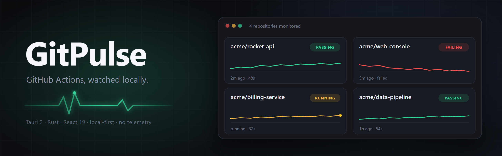
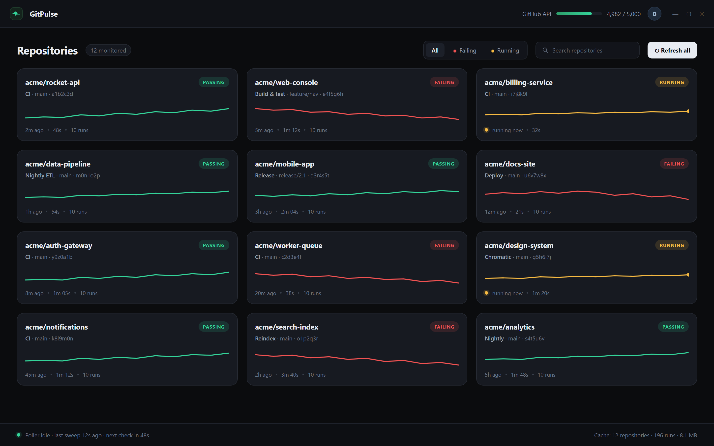

<p align="center">
  
</p>

# GitPulse

<p align="center">
  <a href="https://github.com/n4od/GitPulse/releases/latest"></a>
  <a href="https://github.com/n4od/GitPulse/releases"></a>
  
  <a href="https://tauri.app"></a>
</p>

A local-first desktop monitor for GitHub Actions workflows, deployments and
pull requests. Tauri 2 + Rust core, React 19 frontend, everything cached on
your machine.

<p align="center">
  <a href="https://github.com/n4od/GitPulse/releases/download/v0.5.6/GitPulse-0.5.6-windows-x64-setup.exe"></a>
  <a href="https://github.com/n4od/GitPulse/releases/download/v0.5.6/GitPulse-0.5.6-macos-arm64.dmg"></a>
  <a href="https://github.com/n4od/GitPulse/releases/download/v0.5.6/GitPulse-0.5.6-macos-x64.dmg"></a>
  <a href="https://github.com/n4od/GitPulse/releases/download/v0.5.6/GitPulse-0.5.6-linux-x64.AppImage"></a>
</p>

> **v0.5.6** — installable builds for Windows, macOS and Linux. They are
> unsigned, so the OS asks for confirmation on first launch. What is measured and
> what is not lives in [`VERIFICATION.md`](./VERIFICATION.md).

## Download

The buttons above download the right file directly. Pick the installer if you
want it registered with your OS, or the portable file if you would rather just
run it.

These links are pinned to **v0.5.6**, so they name the file you get and never
change under you. [Older and newer releases](https://github.com/n4od/GitPulse/releases)
carry the same table with their own version in the name.

| Platform                  | Installer                                                                                                                                                                                                            | Portable                                                                                                          |
| :------------------------ | :------------------------------------------------------------------------------------------------------------------------------------------------------------------------------------------------------------------- | :---------------------------------------------------------------------------------------------------------------- |
| **Windows 10/11** (x64)   | [`.exe` (NSIS)](https://github.com/n4od/GitPulse/releases/download/v0.5.6/GitPulse-0.5.6-windows-x64-setup.exe) · [`.msi`](https://github.com/n4od/GitPulse/releases/download/v0.5.6/GitPulse-0.5.6-windows-x64.msi) | [`.zip`](https://github.com/n4od/GitPulse/releases/download/v0.5.6/GitPulse-0.5.6-windows-x64-portable.zip)       |
| **macOS** (Apple Silicon) | [`.dmg`](https://github.com/n4od/GitPulse/releases/download/v0.5.6/GitPulse-0.5.6-macos-arm64.dmg)                                                                                                                   | [`.tar.gz`](https://github.com/n4od/GitPulse/releases/download/v0.5.6/GitPulse-0.5.6-macos-arm64-portable.tar.gz) |
| **macOS** (Intel)         | [`.dmg`](https://github.com/n4od/GitPulse/releases/download/v0.5.6/GitPulse-0.5.6-macos-x64.dmg)                                                                                                                     | [`.tar.gz`](https://github.com/n4od/GitPulse/releases/download/v0.5.6/GitPulse-0.5.6-macos-x64-portable.tar.gz)   |
| **Linux** (x64)           | [`.deb`](https://github.com/n4od/GitPulse/releases/download/v0.5.6/GitPulse-0.5.6-linux-x64.deb)                                                                                                                     | [`.AppImage`](https://github.com/n4od/GitPulse/releases/download/v0.5.6/GitPulse-0.5.6-linux-x64.AppImage)        |

> **Unsigned builds.** Windows SmartScreen shows _More info → Run anyway_;
> macOS Gatekeeper needs right-click → **Open** the first time. There is no
> code-signing certificate behind these releases — [`RELEASING.md`](./RELEASING.md)
> explains why and what signing would take.

## Screenshot



## Requirements

| Tool     | Version | Notes                                                             |
| -------- | ------- | ----------------------------------------------------------------- |
| Rust     | 1.77+   | MSVC toolchain on Windows                                         |
| Node     | 22+     |                                                                   |
| npm      | 11+     |                                                                   |
| WebView2 | any     | Preinstalled on Windows 11; the installer bootstraps it otherwise |

Linux also needs `libwebkit2gtk-4.1-dev`, `libappindicator3-dev`,
`librsvg2-dev`, `patchelf` and `libsecret-1-dev`.

## Getting started

```bash
npm ci
npm run tauri dev
```

On Windows, if `npm` is blocked by the PowerShell execution policy, use
`npm.cmd` instead — the `.ps1` shim cannot load under `Restricted`.

## Webhooks

Polling alone works, and it is the fallback for every situation. Webhooks make
updates arrive in under a second instead of at the next interval.

### Why the three options exist

**GitHub cannot deliver a webhook to `127.0.0.1`.** Deliveries come from
GitHub's servers, and a loopback address means nothing to them. Anything local
therefore needs a public address in front of it, and there are only two honest
ways to get one:

| Option             | What it needs                                | What it costs                                                            |
| ------------------ | -------------------------------------------- | ------------------------------------------------------------------------ |
| **Off** (default)  | Nothing                                      | Updates arrive on the polling interval                                   |
| **Relay**          | A relay URL (smee.io or compatible)          | Deliveries leave GitHub for a third party, which sees the payload bodies |
| **Local + tunnel** | A tunnel you run (`cloudflared`, `ngrok`, …) | You operate it; the payloads stay between GitHub and your machine        |

All three verify the same HMAC signature over the raw body, so none of them is
the weak option. The relay is the least work; the tunnel keeps the payloads off
someone else's server.

### Why smee.io does not work

smee.io parses the webhook JSON and sends it back as a JSON _object_:

```json
{"x-github-event":"workflow_run", "x-hub-signature-256":"sha256=...",
 "body":{"action":"completed","repository":{...}}}
```

The flattened headers are handled. The fatal part is `body`: it is no longer the
bytes GitHub signed. The HMAC covers the _exact_ original bytes, and re-encoding
a parsed object does not reproduce them — keys get reordered, escaping can
differ — so the signature can never match.

GitPulse refuses such a payload and says so:

```
refusing a relayed payload whose body is not raw text; this relay re-encodes
JSON, so its signature cannot be verified. Use a tunnel, or a relay that
forwards the original bytes.
```

Verifying the re-encoded body against itself would accept anything holding the
signing secret and prove nothing about GitHub. **Use a tunnel.** A relay is only
viable if it forwards the original bytes.

### Setting it up

Open the webhook panel from the title bar (the plug icon), pick a transport,
and save. Then:

1. Copy the **signing secret** — the panel reveals it on request.
2. In GitHub, add a webhook to each repository you watch:
   - **Payload URL**: your relay or tunnel URL, plus the path shown in the panel
   - **Content type**: `application/json`
   - **Secret**: the value you just copied
   - **Which events**: I'd like to receive _individual_ events — at minimum
     `Workflow runs`, `Workflow jobs`, `Deployments`, `Pull requests` and
     `Check runs`
3. Press **Test** in the panel to confirm the tunnel reaches GitPulse.

Rotating the secret invalidates the old one immediately, so update GitHub in the
same breath.

### What a delivery does

GitPulse records the delivery ID — so a GitHub retry or a relay replay is ignored —
and then asks the poller to refresh that one repository right away. It does not
apply the payload to the database directly: that keeps the event-to-state
mapping in the one place that already has tests for it, and avoids a second
writer racing the poller.

That means a webhook costs one API request rather than zero. In exchange it is
impossible for a payload GitPulse misreads to leave the cache wrong — the refresh
fetches the truth.

## Scripts

| Command               | What it does                                            |
| --------------------- | ------------------------------------------------------- |
| `npm run dev`         | Vite dev server on `:1420` (Tauri's `beforeDevCommand`) |
| `npm run tauri dev`   | Full desktop app with hot reload                        |
| `npm run build`       | Typecheck + production frontend bundle                  |
| `npm run tauri build` | Unsigned installers for the current OS                  |
| `npm run typecheck`   | `tsc --noEmit` over app and tooling configs             |
| `npm run lint`        | ESLint, zero warnings tolerated                         |
| `npm run test`        | Vitest                                                  |
| `npm run format`      | Prettier                                                |

Rust side:

```bash
cargo fmt   --manifest-path src-tauri/Cargo.toml --all
cargo clippy --manifest-path src-tauri/Cargo.toml --all-targets -- -D warnings
cargo test  --manifest-path src-tauri/Cargo.toml --all-targets
```

## Project layout

```
src/              React application
src/lib/ipc.ts    the only bridge to Rust
src-tauri/        Rust core (commands, auth, db, github, poller, webhook)
src-tauri/migrations/   SQLite migrations
ARCHITECTURE.md   decisions, threat model, module map
ROADMAP.md        milestones and task IDs
CHANGELOG.md      what shipped
VERIFICATION.md   what is proven, and what is not
RELEASING.md      how a tag becomes installers
```

## GitHub authentication

GitPulse uses the OAuth 2.0 **device flow**: no client secret ships in the binary,
and there is no personal access token to paste. You register an app, give GitPulse
its public client id, and approve the sign-in in your browser.

### 1. Register an app

Either app type works. The code branches on what GitHub's token response
actually contains, so nothing needs rebuilding to switch.

**GitHub App** — supports expiring user tokens with rotating refresh tokens, so
GitPulse stays signed in without ever hitting an expiry wall.

1. GitHub → Settings → Developer settings → **GitHub Apps** → **New GitHub App**
2. Homepage / callback URL: `http://127.0.0.1` — the device flow does not use
   them, but the form requires a value
3. Under **Identifying and authorizing users**, tick **Enable Device Flow**
4. Tick **Expire user authorization tokens** to get refresh tokens
5. Save and copy the **Client ID**. GitPulse never needs the client secret.

**OAuth App** — simpler, but the token never expires and there is no refresh.

1. Settings → Developer settings → **OAuth Apps** → **New OAuth App**
2. Tick **Enable Device Flow**
3. Copy the **Client ID**

### 2. Configure GitPulse

```powershell
$env:GITPULSE_GITHUB_CLIENT_ID = "Iv1.0123456789abcdef"
```

An OAuth App also needs scopes requested explicitly, because its permissions
come from the token rather than the app registration:

```powershell
$env:GITPULSE_GITHUB_SCOPES = "repo workflow read:user"
```

`repo` is required for private repositories and `workflow` is required to
re-run or dispatch workflows. Without them GitPulse can still read public sources.

Both variables are read at runtime, falling back to compile-time values of the
same name, so a packaged build can be repointed without a rebuild.

A client id is **not** a secret — it identifies the app, not the user. The
client secret is never requested, stored, or shipped.

### Where tokens live

The access and refresh tokens go to the OS keychain (Windows Credential
Manager, macOS Keychain, Secret Service on Linux) and nowhere else — not to
SQLite, not to a config file, not to the webview. If the keychain is
unavailable, GitPulse falls back to **session-only** in-memory storage and says so
in the log; it never writes a token to disk in plaintext.

## Troubleshooting

**`Cannot find package 'esbuild'` during `npm run build`**
npm 11 skipped esbuild's postinstall. `package.json` pins the approved version
in `allowScripts`; run `npm install-scripts approve esbuild` after upgrading
esbuild.

**`npm : File npm.ps1 cannot be loaded`**
PowerShell execution policy. Use `npm.cmd`.

**Blank window on Linux**
Missing `WEBKIT_DISABLE_COMPOSITING_MODE=1` on some drivers:
`WEBKIT_DISABLE_COMPOSITING_MODE=1 npm run tauri dev`.

## License

MIT — see [`LICENSE`](./LICENSE).
